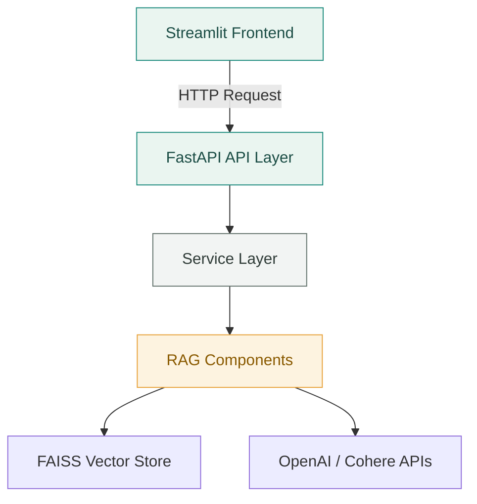
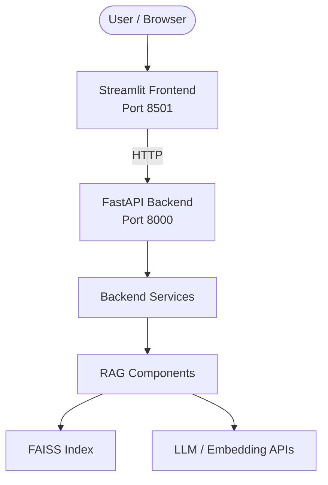
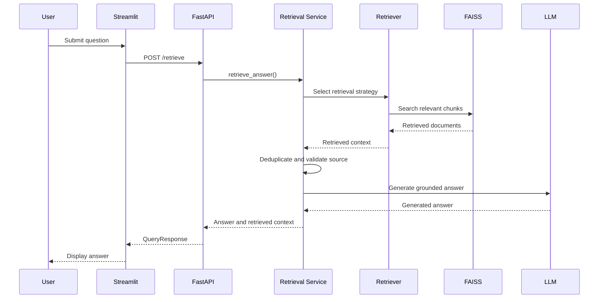
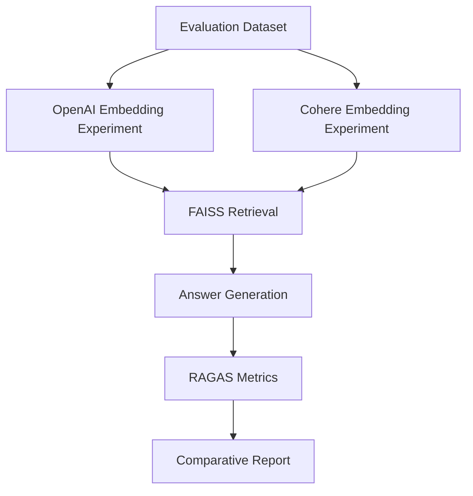
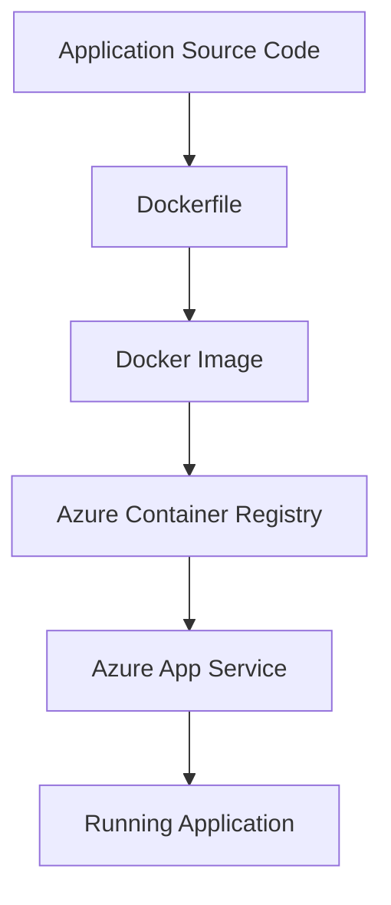

# RAG Multi-Document Assist — Technical Developer Guide

## 1. Project Overview

RAG Multi-Document Assist is a document-based question-answering application built using Retrieval-Augmented Generation (RAG).

The application allows users to upload PDF documents, process and index their content, retrieve relevant information, and generate answers grounded in the uploaded documents.

The system supports multiple embedding models and retrieval strategies, document-level filtering, metadata validation, and offline evaluation using RAGAS.

### Key Capabilities

- PDF document ingestion and text extraction.
- Configurable document chunking.
- OpenAI and Cohere embedding models.
- FAISS vector storage.
- Four retrieval strategies.
- Source-aware document retrieval.
- Context deduplication.
- Context-grounded answer generation.
- Offline RAGAS evaluation.
- Comparative embedding-model benchmarking.
- FastAPI backend and Streamlit frontend.
- Docker-based application packaging.

---

## 2. Technology Stack

| Component | Technology |
|---|---|
| Programming language | Python |
| LLM | OpenAI |
| Embedding models | OpenAI, Cohere |
| LLM orchestration | LangChain |
| Vector store | FAISS |
| Retrieval strategies | Similarity, MMR, Multi-Query, Contextual Compression |
| Reranking | Cohere Rerank |
| Evaluation | RAGAS, LLM-as-a-Judge |
| Backend | FastAPI |
| Frontend | Streamlit |
| Database / vector storage | FAISS |
| Containerization | Docker |
| Logging | Custom application logger |

---

## 3. Project Directory Structure

```text
Production_files/
│
├── src/
│   ├── backend/
│   │   ├── api/
│   │   │   ├── health.py
│   │   │   └── routes.py
│   │   │
│   │   ├── core/
│   │   │   └── config.py
│   │   │
│   │   ├── evaluation/
│   │   │   ├── ragas_eval.py
│   │   │   └── evaluation_runner.py
│   │   │
│   │   ├── logger/
│   │   │   └── customer_logger.py
│   │   │
│   │   ├── rag/
│   │   │   ├── loader.py
│   │   │   ├── splitter.py
│   │   │   ├── embeddings.py
│   │   │   ├── faiss_store.py
│   │   │   ├── retriever_config.py
│   │   │   ├── mmr.py
│   │   │   ├── compression.py
│   │   │   ├── multi_query_retriever.py
│   │   │   ├── deduplicator.py
│   │   │   ├── chain.py
│   │   │   └── llm.py
│   │   │
│   │   ├── services/
│   │   │   ├── ingestion_service.py
│   │   │   └── retrieval_service.py
│   │   │
│   │   └── main.py
│   │
│   ├── frontend/
│   │   ├── app.py
│   │   └── utils.py
│   │
│   └── shared/
│       └── schemas.py
│
├── data/
│   ├── Input_files/
│   ├── evaluation/
│   │   └── evaluation_dataset.json
│   └── faiss_index_*/
│
├── tests/
│   └── integration/
│       ├── test_all_retrievers.py
│       ├── test_chain.py
│       └── test_source_filter.py
│
├── Dockerfile
├── requirements.txt
├── .env
└── README.md
```

**Note:** Runtime indexes, uploaded documents, credentials, and generated evaluation results are local runtime artifacts. They should not be committed to GitHub.

---

## 4. System Architecture

The application follows a layered architecture that separates the frontend, API, business orchestration, and RAG components.

### 4.1 Application Architecture



### 4.2 Runtime Architecture

The application runs as two independent processes.



The frontend communicates with the backend through HTTP requests. It does not directly invoke the RAG components.

### 4.3 Retrieval Request Flow



Offline evaluation is performed separately through the evaluation runner. It is not part of the normal online retrieval request.

---

## 5. Core Components

| Module | Responsibility |
|---|---|
| `loader.py` | Loads and extracts PDF content |
| `splitter.py` | Splits documents into manageable chunks |
| `embeddings.py` | Initializes embedding models |
| `faiss_store.py` | Creates, updates, and validates FAISS indexes |
| `retriever_config.py` | Configures FAISS retrieval and source filters |
| `mmr.py` | Implements Maximum Marginal Relevance retrieval |
| `compression.py` | Implements contextual compression and reranking |
| `multi_query_retriever.py` | Generates alternative search queries |
| `deduplicator.py` | Removes duplicate retrieved documents |
| `chain.py` | Defines the context-grounded generation prompt |
| `llm.py` | Initializes the language model |
| `ingestion_service.py` | Coordinates document ingestion |
| `retrieval_service.py` | Coordinates retrieval and answer generation |
| `ragas_eval.py` | Implements evaluation metrics |
| `evaluation_runner.py` | Runs offline benchmark experiments |

---

## 6. Document Ingestion Workflow

Document ingestion converts uploaded PDFs into searchable vector representations.

### Processing Steps

1. User uploads a PDF through the frontend.
2. FastAPI receives the document.
3. The ingestion service loads the PDF.
4. Extracted content is divided into chunks.
5. The selected embedding model generates vectors.
6. Metadata is attached to each chunk.
7. FAISS indexing validates and stores the document chunks.

### Document Metadata

The implementation uses important metadata fields:

| Metadata | Purpose |
|---|---|
| `source_id` | Identifies the source document |
| `chunk_id` | Uniquely identifies a document chunk |
| `file_hash` | Identifies the uploaded file version |
| `source` | Stores the original source filename |
| `page` | Identifies the source page |

### Why Metadata Matters

- `source_id` enables document-specific retrieval.
- `chunk_id` supports unique chunk identification.
- `file_hash` helps identify unchanged or updated documents.
- `source` and `page` support document traceability.

The FAISS indexing layer validates required metadata before storing documents.

---

## 7. Retrieval Strategies

The application supports four retrieval strategies.

### 7.1 FAISS Similarity Retrieval

Uses vector similarity to identify the most relevant document chunks.

The implementation supports:

- Global document retrieval.
- Source-specific retrieval.
- Configurable retrieval count.

### 7.2 Maximum Marginal Relevance (MMR)

MMR balances relevance and diversity.

Instead of returning only highly similar chunks, MMR attempts to reduce redundancy while maintaining relevance.

### 7.3 Contextual Compression

Contextual compression retrieves an initial set of documents and applies Cohere reranking to prioritize relevant results.

Current reranker configuration:

- Model: `rerank-v3.5`
- Initial retrieval count: 20
- Final reranked context count: 5

### 7.4 Multi-Query Retrieval

Multi-query retrieval generates alternative versions of the original question.

These queries improve the chances of finding relevant content expressed using different terminology.

The implementation includes the original query alongside generated alternatives.

### Global vs Source-Specific Retrieval

| Retrieval mode | Behaviour |
|---|---|
| Global | Searches across all indexed documents |
| Source-specific | Restricts retrieval to the selected document using `source_id` |

Source-specific retrieval is particularly useful when users upload multiple policy documents and want answers restricted to one selected policy.

---

## 8. Context Processing and Answer Generation

After retrieval, the system processes the returned documents before sending context to the LLM.

### Processing Steps

1. Retrieve relevant chunks.
2. Remove duplicate documents.
3. Validate source identity when a source filter is supplied.
4. Combine retrieved content into context.
5. Pass the context and question to the conversational chain.
6. Generate the final answer.

### Context-Grounded Generation

The generation prompt is designed to:

- Answer using the supplied context.
- Avoid unsupported external information.
- Preserve important numbers and conditions.
- Avoid guessing when information is unavailable.
- Return a clear fallback when the answer is absent.

Expected fallback:

```text
Answer is not available in the provided context.
```

This approach is particularly important for policy documents, where incorrect numerical values or omitted conditions can change the meaning of an answer.

---

## 9. RAG Evaluation Framework

Evaluation is performed offline using the evaluation runner.

The framework compares OpenAI and Cohere embedding configurations using a common evaluation dataset.

### Evaluation Architecture



### Evaluation Metrics

| Metric | What it measures |
|---|---|
| Context Precision | Relevance of retrieved context |
| Response Relevancy | Relevance of the generated answer to the question |
| Context Recall | Whether the retrieved context supports the reference answer |
| Factual Correctness | Agreement between the generated answer and reference answer |
| Faithfulness | Whether the generated answer is supported by retrieved context |
| Hallucination | Derived score: `1 - Faithfulness` |
| LLM Judge | Custom LLM-based answer assessment |

### Comparative Benchmark

The evaluation dataset contains 15 questions across three HDFC Life policy documents.

The experiments compare:

- OpenAI `text-embedding-3-small`
- Cohere `embed-english-v3.0`

Both experiments use the same evaluation embedding configuration for Response Relevancy, keeping that evaluation component consistent.

The evaluation runner generates individual model reports and a comparative benchmark report.

**Important:** Evaluation scores are experimental measurements from the current dataset and configuration. They should not be treated as universal performance guarantees.

---

## 10. Installation and Execution

Run commands from the `Live/Production_files/` directory unless stated otherwise.

### 10.1 Activate the Virtual Environment

If the existing project virtual environment is located at the repository root:

PowerShell:

```powershell
cd D:\AI Engineer practice\RAG-Multi-Document-Assist
.\.venv\Scripts\Activate.ps1
cd Live\Production_files
```

### 10.2 Install Dependencies

```bash
pip install -r requirements.txt
```

### 10.3 Configure Environment Variables

Create or update the `.env` file with the required credentials.

Example:

```env
OPENAI_API_KEY=your_openai_api_key
COHERE_API_KEY=your_cohere_api_key
OPENAI_MODEL=gpt-4o-mini
```

Use the actual model configuration expected by the application.

Never commit `.env` or expose API keys in source code.

### 10.4 Start FastAPI

From `Live/Production_files/`:

```bash
uvicorn src.backend.main:app --host 0.0.0.0 --port 8000
```

API documentation:

```text
http://localhost:8000/docs
```

### 10.5 Start Streamlit

Open another terminal, activate the same environment, and run:

```bash
cd Live/Production_files
python -m streamlit run src/frontend/app.py
```

Open:

```text
http://localhost:8501
```

Upload a PDF, ingest the document, and submit a question.

---

## 11. Testing

Integration tests are maintained under:

```text
tests/integration/
```

### Available Tests

| Test | Purpose |
|---|---|
| `test_source_filter.py` | Validates source-specific and global FAISS retrieval |
| `test_all_retrievers.py` | Exercises all four retrieval strategies |
| `test_chain.py` | Tests chain initialization, answer generation, and missing-context fallback |

### Run Individual Tests

From `Live/Production_files/`:

```bash
python tests/integration/test_source_filter.py
```

```bash
python tests/integration/test_all_retrievers.py
```

```bash
python tests/integration/test_chain.py
```

These tests require the appropriate environment variables and local FAISS indexes. Tests that invoke external APIs also require valid API credentials and network access.

### Evaluation Runner

Run the offline comparative benchmark using:

```bash
python -m src.backend.evaluation.evaluation_runner
```

The runner uses the evaluation dataset and the configured local embedding indexes.

---

## 12. Docker and Deployment

The application includes a Dockerfile for containerization.

Build the image from the production application directory:

```bash
docker build -t rag-multi-document-assist .
```

Run the container using the environment variables and port configuration required by the Dockerfile:

```bash
docker run --env-file .env -p 8000:8000 rag-multi-document-assist
```

Check the Dockerfile and application entry point for the actual service startup configuration before deployment.

Deployment configuration should be maintained separately from application source code.

---

## 13. Development Guidelines

### Coding Practices

- Keep API routes lightweight.
- Place business orchestration inside service modules.
- Keep retrieval strategies independently maintainable.
- Validate metadata before indexing.
- Use structured logging.
- Keep evaluation outside the online retrieval path.
- Handle external API failures explicitly.
- Avoid hardcoding credentials or environment-specific paths.

### Git Commit Convention

Use meaningful commit prefixes:

| Prefix | Purpose |
|---|---|
| `feat:` | New functionality |
| `fix:` | Bug fixes |
| `refactor:` | Code restructuring |
| `test:` | Test additions or modifications |
| `docs:` | Documentation updates |
| `chore:` | Maintenance and configuration |

Example:

```bash
git commit -m "feat: add source-aware retrieval across retrievers"
```

---

## 14. Known Limitations and Future Enhancements

Potential areas for further improvement:

1. Improve retrieval ranking for numerical and formula-based questions.
2. Add more diverse evaluation questions and reference answers.
3. Expand automated regression testing.
4. Introduce hybrid keyword and vector retrieval.
5. Explore advanced reranking strategies.
6. Add retrieval latency and token-usage tracking.
7. Improve observability and failure reporting.
8. Add authentication and authorization for multi-user deployments.
9. Explore scalable vector storage for larger document collections.

These are proposed improvements, not claims about currently implemented functionality.

---

## 15. Project Learning and Engineering Takeaways

This project demonstrates the practical engineering challenges involved in building a production-oriented RAG application.

Important areas explored include:

- PDF processing and chunking.
- Embedding model integration.
- FAISS indexing and metadata management.
- Source-aware retrieval.
- Retrieval strategy comparison.
- Context deduplication.
- Grounded LLM generation.
- Offline RAGAS evaluation.
- Comparative benchmarking.
- API and frontend integration.
- Integration testing.
- Git version control and project documentation.

The primary engineering objective is to build a RAG system that is not only capable of generating answers, but also supports document traceability, controlled retrieval, measurable evaluation, and maintainable application architecture.

---

**Repository:** Multi-Document Assist
**Documentation:** Technical Developer Guide
**Application:** RAG Multi-Document Assist

## 12. Azure Containerization and Deployment Architecture

The application supports Docker-based containerization and Azure deployment.

The deployment architecture uses Azure Container Registry (ACR) to store container images and Azure App Service to host the containerized application.

### 12.1 Deployment Architecture



### 12.2 Deployment Components

| Component | Responsibility |
|---|---|
| Docker | Packages the application and dependencies |
| Dockerfile | Defines the container build instructions |
| Azure Container Registry | Stores and manages Docker images |
| Azure App Service | Hosts and runs the containerized application |
| Azure Resource Group | Organizes the Azure resources |
| Azure CLI | Automates Azure resource management and deployment |

### 12.3 Deployment Workflow

The deployment process follows these stages:

1. Build the Docker image locally.
2. Authenticate with Azure.
3. Authenticate with Azure Container Registry.
4. Tag the Docker image with the ACR registry name.
5. Push the image to ACR.
6. Configure Azure App Service to use the image.
7. Configure application environment variables.
8. Verify application startup and health.

### 12.4 Example Deployment Commands

Authenticate with Azure:

```bash
az login
```

Authenticate with ACR:

```bash
az acr login --name <registry-name>
```

Build the image:

```bash
docker build -t <image-name>:latest .
```

Tag the image:

```bash
docker tag <image-name>:latest \
<registry-name>.azurecr.io/<image-name>:latest
```

Push the image:

```bash
docker push \
<registry-name>.azurecr.io/<image-name>:latest
```

Configure Azure App Service to use the container image through the Azure Portal or Azure CLI.

### 12.5 Deployment Automation

Where available in the repository, the Azure deployment scripts support:

- Resource group creation.
- Azure Container Registry provisioning.
- Container image publishing.
- App Service provisioning.
- Application configuration.
- Deployment and teardown.

### 12.6 Deployment Challenges Encountered

The following practical issues were encountered during deployment:

| Issue | Engineering consideration |
|---|---|
| `TasksOperationsNotAllowed` | ACR resource creation restrictions on certain free/student subscriptions |
| Container port mismatch | Aligning the Docker container port with the App Service configuration |
| Missing `OPENAI_MODEL` | Configuring required application environment variables |
| Azure CLI deployment issue | Using the Azure Portal as a workaround where necessary |

### 12.7 Resource Management

Azure resources should be stopped or deleted when they are no longer required to avoid unnecessary charges.

Use the deployment teardown procedure where available.