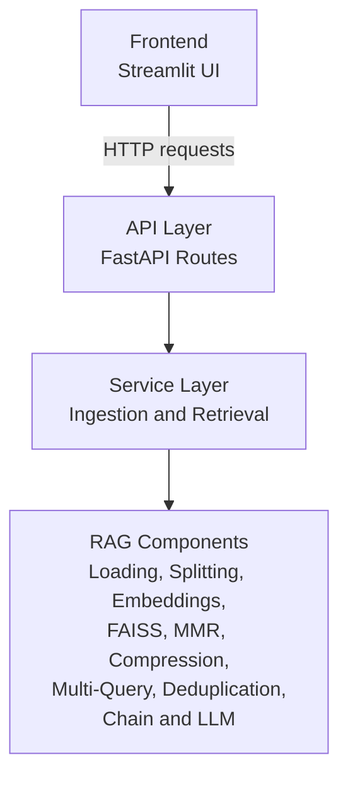
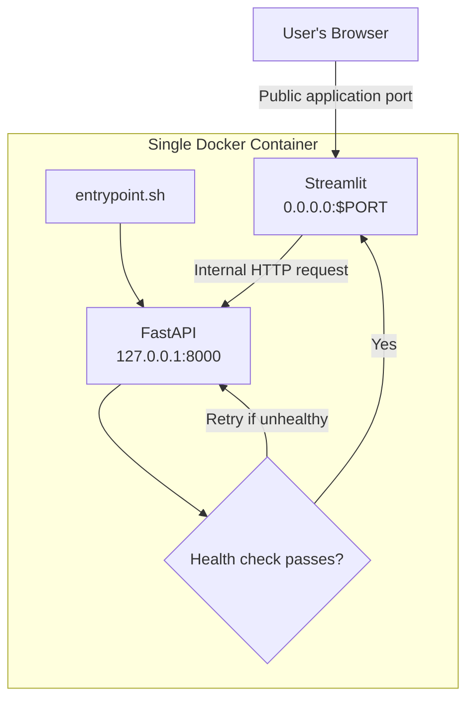
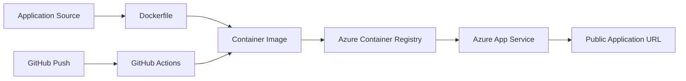
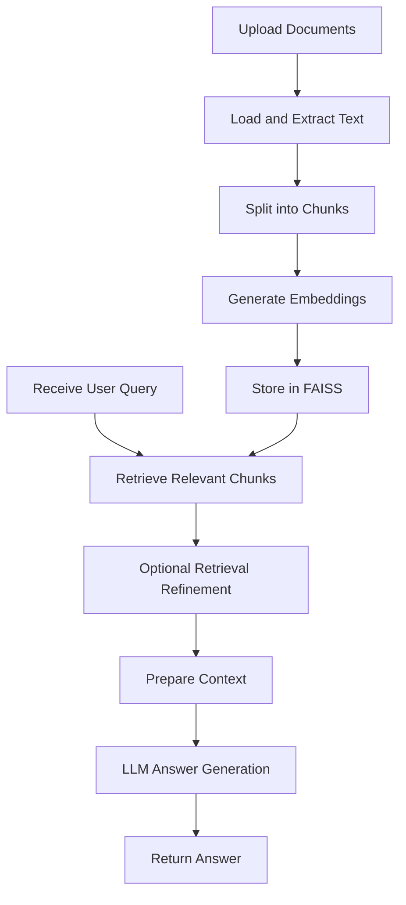

# Multi-Document-Assist

### Production-Oriented Retrieval-Augmented Generation (RAG) Application

**Multi-Document-Assist** is a document question-answering application designed to help users upload documents and retrieve context-aware answers based on their content.

Built with Python, FastAPI, Streamlit, and FAISS, the application organizes document ingestion and retrieval into modular components. Its architecture separates the user interface, API layer, orchestration services, and RAG building blocks to support maintainability, debugging, and future enhancements.

> **Core objective:** Enable users to ask questions about uploaded documents and receive relevant answers grounded in retrieved document context.

**Technology focus:** Generative AI · Retrieval-Augmented Generation (RAG) · Vector Search · LLM Integration · FastAPI · Docker · Cloud Deployment

---

## Table of Contents

* [Project Overview](#project-overview)
* [Key Features](#key-features)
* [Technology Stack](#technology-stack)
* [System Architecture](#system-architecture)
* [RAG Pipeline](#rag-pipeline)
* [Project Structure](#project-structure)
* [Getting Started](#getting-started)
* [Running Locally](#running-locally)
* [Running with Docker](#running-with-docker)
* [API Overview](#api-overview)
* [Deployment](#deployment)
* [Evaluation and Testing](#evaluation-and-testing)
* [Security Considerations](#security-considerations)
* [Limitations and Future Improvements](#limitations-and-future-improvements)
* [Learning Outcomes](#learning-outcomes)
* [License](#license)

---

## Project Overview

Traditional document review often requires users to search through lengthy files manually to find relevant information.

Multi-Document-Assist explores how Retrieval-Augmented Generation can make document information easier to access.

The application separates document processing, retrieval, and answer generation into distinct components. This separation makes it easier to understand the pipeline, troubleshoot individual components, and experiment with retrieval strategies.

### The Problem

* Finding relevant information in multiple documents can be time-consuming.
* Keyword-based searches may not retrieve the most contextually relevant passages.
* LLM responses need relevant source context to help reduce unsupported answers.
* Monolithic implementations can be difficult to debug and extend.

### The Solution

The application provides a modular RAG workflow that combines document processing, vector-based retrieval, retrieval refinement, and LLM-based answer generation.

The intended outcome is a more convenient way to query document collections through a user-facing application.

---

## Key Features

The repository includes components for the following capabilities. Confirm each feature against the current implementation before presenting it as fully operational.

* **Document ingestion:** Components for loading documents into the RAG pipeline.
* **Text splitting:** Document chunking to prepare content for retrieval.
* **Configurable embeddings:** Support for OpenAI and Cohere embedding configurations.
* **FAISS vector storage:** Vector indexing and similarity-based retrieval.
* **Multi-query retrieval:** A component for exploring retrieval using multiple query formulations.
* **Maximum Marginal Relevance (MMR):** A retrieval strategy intended to balance relevance and diversity.
* **Context compression:** A component for refining retrieved context.
* **Deduplication:** A component for reducing duplicate retrieved content.
* **LLM integration:** Components for configuring the language model and generating answers.
* **FastAPI backend:** API layer for application operations.
* **Streamlit frontend:** Browser-based user interface.
* **Docker packaging:** Container-based application deployment.
* **Cloud deployment support:** Azure deployment scripts and a GitHub Actions workflow.
* **RAG evaluation:** A RAGAS evaluation module for evaluating retrieval and answer quality.

---

## Technology Stack

| Category             | Technology                                   | Purpose                                    |
| -------------------- | -------------------------------------------- | ------------------------------------------ |
| Programming language | Python                                       | Application development                    |
| LLM framework        | LangChain components                         | RAG pipeline orchestration and integration |
| LLM provider         | OpenAI                                       | Language-model integration                 |
| Embeddings           | OpenAI / Cohere                              | Document and query representations         |
| Vector store         | FAISS                                        | Vector indexing and retrieval              |
| Backend              | FastAPI                                      | HTTP API layer                             |
| Frontend             | Streamlit                                    | User interface                             |
| Evaluation           | RAGAS                                        | RAG evaluation workflows                   |
| Containerization     | Docker                                       | Packaging and running the application      |
| Cloud deployment     | Azure App Service / Azure Container Registry | Container hosting and image storage        |
| CI/CD                | GitHub Actions                               | Automated deployment workflow              |

The technologies listed above reflect the intended stack. Exact package versions and active provider configurations are defined by the project dependencies and environment settings.

---

## System Architecture

The system has three distinct architectural views:

1. Application architecture — how the source code is organized.
2. Runtime architecture — how the frontend and backend processes communicate.
3. Deployment architecture — how the container is built and hosted.

Keeping these views separate helps isolate problems. An issue in a retrieval component does not necessarily indicate a problem with the container or cloud deployment.

### 1. Application Architecture — Code Layers

The application is organized into layers with distinct responsibilities.



**Layer responsibilities**

| Layer          | Responsibility                                                           |
| -------------- | ------------------------------------------------------------------------ |
| Frontend       | Collect user input and present results                                   |
| API            | Expose application endpoints and validate requests                       |
| Services       | Orchestrate ingestion and retrieval workflows                            |
| RAG components | Implement document processing, retrieval, and generation building blocks |

The frontend communicates with the backend through the API rather than directly invoking the RAG components.

The API routes delegate workflow execution to the service layer, which coordinates the underlying components.

This separation improves maintainability and makes individual components easier to test.

### 2. Runtime Architecture — One Container, Two Processes

The Docker configuration is designed to run FastAPI and Streamlit within the same container.

The intended runtime arrangement is:

* FastAPI listens on the container's loopback interface at `127.0.0.1:8000`.
* Streamlit listens on `0.0.0.0:$PORT`, using `8080` as the default port.
* The entrypoint starts FastAPI and checks its health before starting Streamlit.
* The browser accesses the application through the Streamlit port.
* Streamlit communicates with FastAPI through the container's loopback interface.



**Why this design?**

It keeps the backend from being directly exposed through the application's public port while providing a browser-accessible interface.

The actual network exposure depends on the Docker configuration and hosting environment. Binding FastAPI to loopback does not, by itself, replace a complete security review.

If FastAPI's Swagger interface at `/docs` returns `404` on the public application URL, that is consistent with a deployment that exposes only Streamlit. Verify the actual routes and hosting configuration before diagnosing the cause.

### 3. Deployment Architecture — Source Code to Public URL

The repository includes Docker and Azure deployment assets intended to support a container-based deployment workflow.



The intended workflow is:

1. Build the application image from the Dockerfile.
2. Push the image to Azure Container Registry.
3. Configure Azure App Service to use the image.
4. Supply the required application settings securely.
5. Verify application health and functionality after deployment.

The exact deployment process depends on the Azure subscription, permissions, registry configuration, and workflow settings.

See [`Live/Production_files/deploy/azure/README.md`](Live/Production_files/deploy/azure/README.md) for the repository's Azure deployment instructions.

---

## RAG Pipeline

Retrieval-Augmented Generation combines document retrieval with language-model generation.

The application's modular components support the following conceptual workflow:



### Pipeline Stages

**1. Document ingestion**

Documents are loaded and prepared for downstream processing.

**2. Text splitting**

Extracted text is divided into smaller chunks to support retrieval at a manageable level of granularity.

**3. Embedding generation**

Text chunks are converted into vector representations using the configured embedding provider.

**4. Vector indexing**

The resulting vectors are stored in a FAISS index for similarity-based retrieval.

**5. Query processing**

A user's question is processed and used to retrieve potentially relevant document chunks.

**6. Retrieval refinement**

The repository contains components for techniques such as multi-query retrieval, MMR, context compression, and deduplication. Their actual use depends on the configured retrieval workflow.

**7. Context preparation**

Retrieved passages are prepared for the language model.

**8. Answer generation**

The language model generates a response using the supplied context and query.

**9. Response delivery**

The application returns the generated answer through its user-facing interface.

> **Important:** The presence of a component in the repository does not necessarily mean every request uses that component. The actual execution order is determined by the application code and configuration.

---

## Project Structure

The production-oriented application files are located under `Live/Production_files/`.

```text
Multi-Doc-Assist/
├── .gitignore
├── README.md
└── Live/
    └── Production_files/
        ├── .dockerignore
        ├── Dockerfile
        ├── entrypoint.sh
        ├── requirements.txt
        │
        ├── .github/
        │   └── workflows/
        │       └── azure-deploy.yml
        │
        ├── deploy/
        │   └── azure/
        │       ├── README.md
        │       ├── azure-webapp.bicep
        │       ├── deploy.sh
        │       ├── load_env.sh
        │       └── teardown.sh
        │
        ├── src/
        │   ├── backend/
        │   │   ├── api/
        │   │   ├── core/
        │   │   ├── evaluation/
        │   │   ├── logger/
        │   │   ├── rag/
        │   │   └── services/
        │   │
        │   ├── frontend/
        │   │   ├── app.py
        │   │   └── utils.py
        │   │
        │   └── shared/
        │       └── schemas.py
        │
        └── data/
            ├── Input_files/
            └── FAISS index directories/
```

The diagram is representative rather than exhaustive. Check the current repository for exact filenames and any additional modules.

### Important Directories

| Path                      | Purpose                                                               |
| ------------------------- | --------------------------------------------------------------------- |
| `src/backend/api/`        | API routes and endpoint logic                                         |
| `src/backend/core/`       | Backend configuration and shared core functionality                   |
| `src/backend/evaluation/` | Evaluation-related code                                               |
| `src/backend/rag/`        | RAG pipeline components                                               |
| `src/backend/services/`   | Ingestion and retrieval orchestration                                 |
| `src/frontend/`           | Streamlit application                                                 |
| `src/shared/`             | Shared schemas and data structures                                    |
| `data/Input_files/`       | Input documents used by the application                               |
| `data/` FAISS directories | Persisted vector-index artifacts, if used by the active configuration |
| `deploy/azure/`           | Azure deployment scripts and documentation                            |
| `.github/workflows/`      | GitHub Actions workflow configuration                                 |

---

## Getting Started

### Prerequisites

Install the following tools before running the application:

* Python 3.12, as used in the example setup below.
* Git.
* An OpenAI API key if using OpenAI-backed functionality.
* A Cohere API key if using Cohere-backed functionality.
* Docker Desktop if you want to run the containerized application.

Check the Python version:

```bash
python --version
```

If the project uses a different Python version in its deployment environment, align your local environment with the project's tested configuration.

### 1. Clone the Repository

```bash
git clone https://github.com/venkatarachanta-create/Multi-Doc-Assist.git
cd Multi-Doc-Assist
```

### 2. Navigate to the Application Directory

The application code and dependency file are nested under `Live/Production_files/`.

```bash
cd Live/Production_files
```

Run the following commands from this directory unless otherwise specified.

### 3. Create a Virtual Environment

**Windows PowerShell**

```powershell
py -3.12 -m venv .venv
.\.venv\Scripts\Activate.ps1
```

If PowerShell prevents activation because of its execution policy, use an approved activation method for your environment rather than changing system-wide security settings unnecessarily.

**Windows Command Prompt**

```bat
py -3.12 -m venv .venv
.venv\Scripts\activate.bat
```

**macOS / Linux**

```bash
python3.12 -m venv .venv
source .venv/bin/activate
```

### 4. Install Dependencies

```bash
python -m pip install --upgrade pip
pip install -r requirements.txt
```

### 5. Configure Environment Variables

Create a local `.env` file only if the application configuration supports loading it. Otherwise, supply the variables through your shell or deployment environment.

Example:

```dotenv
OPENAI_API_KEY=your_openai_api_key
COHERE_API_KEY=your_cohere_api_key
OPENAI_MODEL=gpt-4o-mini
```

Use only the credentials required by your selected configuration.

**Security rules:**

* Never commit API keys or other secrets.
* Do not paste real credentials into issues, screenshots, or documentation.
* Keep `.env` files excluded from Git.
* Use the hosting platform's secret or application-setting mechanism in production.
* Never place real credentials directly in Docker build instructions or source code.

The environment-variable names and defaults above should match the actual application configuration. Review the relevant configuration modules before relying on them.

---

## Running Locally

### 1. Start FastAPI

Open a terminal in `Live/Production_files/` with the virtual environment activated.

```bash
python -m uvicorn src.backend.main:app --host 127.0.0.1 --port 8000
```

The backend should become available at:

```text
http://127.0.0.1:8000
```

If the application exposes FastAPI's default OpenAPI interface locally, its documentation may be available at:

```text
http://127.0.0.1:8000/docs
```

If the command fails, confirm that `src/backend/main.py` exists and exports an ASGI application named `app`.

### 2. Start Streamlit

Open a second terminal in the same `Live/Production_files/` directory and activate the same virtual environment.

```bash
python -m streamlit run src/frontend/app.py
```

Streamlit normally displays its local application URL in the terminal. Open that address in your browser.

### Local Runtime Notes

* Start FastAPI before testing features that call the backend.
* Keep both processes running while using the application.
* Ensure the frontend's backend URL matches the address and port used by FastAPI.
* The local development commands above run two separate processes; they do not reproduce the single-container startup process.

---

## Running with Docker

The Docker configuration is designed to run the backend and frontend within one container.

Run the following commands from `Live/Production_files/`, where the Dockerfile is located.

### 1. Build the Image

```bash
docker build -t multi-document-assist .
```

### 2. Run the Container

**Windows PowerShell**

```powershell
docker run --rm -p 8080:8080 `
  -e OPENAI_API_KEY="$env:OPENAI_API_KEY" `
  -e COHERE_API_KEY="$env:COHERE_API_KEY" `
  -e OPENAI_MODEL="gpt-4o-mini" `
  multi-document-assist
```

**macOS / Linux**

```bash
docker run --rm -p 8080:8080 \
  -e OPENAI_API_KEY="$OPENAI_API_KEY" \
  -e COHERE_API_KEY="$COHERE_API_KEY" \
  -e OPENAI_MODEL="gpt-4o-mini" \
  multi-document-assist
```

Set the environment variables in your shell before running the command. If the application uses only one embedding provider, supply only the credentials it requires.

### 3. Open the Application

```text
http://localhost:8080
```

The Docker container's public application port is intended to serve Streamlit. FastAPI uses the internal loopback address described in the runtime architecture.

If the container exits or the application does not load, inspect the logs:

```bash
docker ps -a
docker logs <container_id>
```

Replace `<container_id>` with the actual container ID.

---

## API Overview

The architecture describes the following application operations:

| Method | Endpoint    | Intended purpose                                                  |
| ------ | ----------- | ----------------------------------------------------------------- |
| `POST` | `/upload`   | Submit documents for ingestion                                    |
| `POST` | `/retrieve` | Submit a query for document-based retrieval and answer generation |
| `GET`  | `/health`   | Check backend health                                              |

Confirm the exact endpoint paths, request schemas, response formats, and authentication behavior against the FastAPI route definitions before integrating another client.

The `/health` endpoint is also used by the container startup process, according to the documented runtime design.

---

## Deployment

### Render

The repository has previously been associated with this application URL:

**Application:** https://multi-document-assist.onrender.com

Verify that the service is still active and that document upload and retrieval work before presenting it as a live demo.

If the service is unavailable, update the README to explain that the hosted demo is temporarily offline rather than implying that it is operational.

### Azure App Service

The repository includes deployment assets for Azure App Service and Azure Container Registry.

Relevant files include:

* `deploy/azure/README.md`
* `deploy/azure/azure-webapp.bicep`
* `deploy/azure/deploy.sh`
* `deploy/azure/load_env.sh`
* `deploy/azure/teardown.sh`
* `.github/workflows/azure-deploy.yml`

Review the actual location of the GitHub Actions workflow in the repository before using it. GitHub Actions automatically discovers workflows from the repository's designated `.github/workflows/` directory; a workflow nested elsewhere will not be discovered automatically.

### Azure Deployment Workflow

The intended process is:

1. Configure the Azure subscription and required permissions.
2. Create or configure Azure Container Registry.
3. Build and publish the Docker image.
4. Configure Azure App Service to use that image.
5. Set the required environment variables securely.
6. Configure the application port.
7. Verify the application health endpoint and frontend.
8. Test document ingestion and question answering.

Azure subscription restrictions may affect whether images can be built in Azure or need to be built and pushed from a local Docker installation.

### GitHub Actions

The repository includes an Azure deployment workflow. To use it, verify that:

* The workflow is located under the repository's root `.github/workflows/` directory.
* The required GitHub secrets and variables are configured.
* The Azure identity has the necessary permissions.
* Registry authentication and image names match the deployment configuration.
* The workflow completes successfully.
* The deployed application passes a post-deployment health check.

A workflow file being present does not, by itself, demonstrate that CI/CD is operational.

For detailed instructions, consult [`deploy/azure/README.md`](Live/Production_files/deploy/azure/README.md).

---

## Evaluation and Testing

A reliable RAG application should be evaluated on more than whether it returns an answer.

The repository includes a RAGAS evaluation module. Use it to build a reproducible evaluation process and document the results after running the evaluation against a defined dataset.

### Suggested Evaluation Dimensions

| Dimension           | What to evaluate                                                                                |
| ------------------- | ----------------------------------------------------------------------------------------------- |
| Retrieval relevance | Whether retrieved passages are relevant to the question                                         |
| Context recall      | Whether the retrieval process captures the information needed to answer                         |
| Faithfulness        | Whether the generated answer is supported by the retrieved context                              |
| Answer relevance    | Whether the response addresses the user's question                                              |
| Latency             | How long ingestion, retrieval, and generation take                                              |
| Cost                | Token usage and model or embedding costs, where measurable                                      |
| Robustness          | How the application handles missing information, malformed requests, and unsupported file types |

The availability and precise definitions of individual metrics depend on the evaluation implementation and dataset.

### Recommended Test Cases

1. Ask a question whose answer is explicitly stated in a document.
2. Ask a question that requires combining information from multiple documents.
3. Ask a question whose answer is absent from the uploaded documents.
4. Test an empty or malformed query.
5. Upload an unsupported or invalid document.
6. Test duplicate or overlapping document content.
7. Compare retrieval behavior across supported embedding configurations.
8. Test the API's response to invalid requests and unavailable dependencies.
9. Restart the application and verify the expected behavior of persisted indexes.
10. Test the container startup and health-check sequence.

### Reporting Results

Once the evaluation has been executed, add a results table with:

* Dataset size and composition.
* Model and embedding configuration.
* Retrieval settings.
* Evaluation metrics and scores.
* Average and percentile latency, if measured.
* Test environment and date.
* Known limitations.

**Do not publish invented scores or performance claims.** Record measured results, including negative findings and known limitations.

---

## Security Considerations

Document-processing applications may handle sensitive information. Security should be considered throughout ingestion, storage, retrieval, logging, and deployment.

* **API credentials:** Store keys in environment variables or a managed secrets service.
* **Uploaded documents:** Avoid committing private, personal, or confidential documents to a public repository.
* **Redistribution rights:** Ensure sample documents can legally be shared.
* **Input validation:** Validate uploads, request schemas, file types, and file sizes.
* **Logging:** Avoid logging API keys, sensitive document text, or unnecessary personal information.
* **Network exposure:** Expose only the services and ports required by the deployment.
* **Dependency management:** Review package versions and security advisories.
* **Access control:** Add authentication and authorization before using the application with private documents in a multi-user production environment.
* **Resource limits:** Consider upload limits, processing timeouts, and rate limiting to reduce abuse and unexpected costs.
* **Document isolation:** Ensure one user's documents and retrieved content cannot be accessed by another user without authorization.

Before making this repository public, inspect tracked PDFs, FAISS index files, logs, environment files, and Git history for secrets or sensitive content.

If sensitive material was committed, deleting it from the latest version is not sufficient to remove it from previous commits. A history cleanup may be necessary, and any exposed credentials must be rotated.

---

## Limitations and Future Improvements

Potential areas for further development include:

* Add automated unit and integration tests.
* Add a reproducible benchmark dataset for RAG evaluation.
* Report measured retrieval quality and end-to-end latency.
* Improve source attribution so answers can be traced to document passages or page numbers.
* Add explicit handling for questions that cannot be answered from the available context.
* Introduce authentication and user-level document isolation.
* Improve document-format validation and ingestion error reporting.
* Add monitoring, structured logs, and production health checks.
* Add automated deployment verification and rollback procedures.
* Evaluate persistence and recovery behavior for vector indexes.
* Document deployment cost and resource requirements.

These are suggested improvements, not claims that the features are already implemented.

---

## Learning Outcomes

This project provides an opportunity to explore and demonstrate:

* Retrieval-Augmented Generation application design.
* Document loading, chunking, and embedding workflows.
* Vector search using FAISS.
* Retrieval refinement techniques such as MMR and multi-query retrieval.
* Modular backend design with FastAPI.
* Frontend integration using Streamlit.
* Containerization with Docker.
* Environment-based configuration.
* Cloud deployment concepts using Azure App Service and Azure Container Registry.
* RAG evaluation and quality measurement.

---

## License

Add a license before encouraging reuse or redistribution of this project.

If no license has been selected, state that the project is not yet licensed for reuse. Also confirm that any sample documents and other third-party assets can legally be distributed with the repository.

---

## Author

**Multi-Document-Assist**

A portfolio project exploring modular RAG application development, document retrieval, LLM integration, and container-based deployment.

**Repository:** https://github.com/venkatarachanta-create/Multi-Doc-Assist

**Project focus:** Generative AI · RAG · Python · FastAPI · FAISS · Streamlit · Docker · Azure
