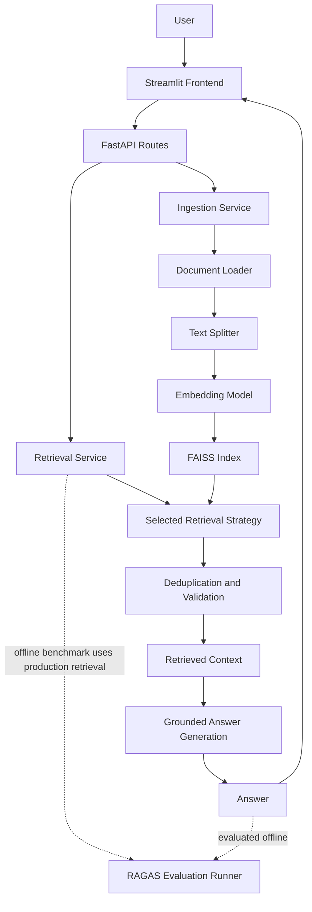

# Multi-Document-Assist

### Production-Oriented Retrieval-Augmented Generation (RAG) Application

Multi-Document-Assist is a document question-answering application built with Python, LangChain, FastAPI, Streamlit, and FAISS. It supports document ingestion, vector indexing, multiple retrieval strategies, source-aware filtering, context-grounded answer generation, and offline RAG evaluation.

**Core objective:** Let users ask questions about uploaded documents and receive answers grounded in retrieved document context.

**Technology focus:** Generative AI · RAG · LangChain · FAISS · OpenAI · Cohere · FastAPI · Streamlit · RAGAS · Docker

---

## Table of Contents

- [Project Overview](#project-overview)
- [Key Features](#key-features)
- [Technology Stack](#technology-stack)
- [System Architecture](#system-architecture)
- [RAG Pipeline](#rag-pipeline)
- [Source-Aware Retrieval](#source-aware-retrieval)
- [Evaluation and Benchmark Results](#evaluation-and-benchmark-results)
- [Integration Testing](#integration-testing)
- [Project Structure](#project-structure)
- [Getting Started](#getting-started)
- [Running with Docker](#running-with-docker)
- [API Overview](#api-overview)
- [Deployment](#deployment)
- [Security Considerations](#security-considerations)
- [Limitations and Future Improvements](#limitations-and-future-improvements)
- [Learning Outcomes](#learning-outcomes)
- [License](#license)

---

## Project Overview

Traditional document review often requires users to search lengthy files manually. Keyword searches may miss semantically relevant passages, while an LLM without relevant source context can produce unsupported answers.

Multi-Document-Assist uses a modular RAG workflow to process documents, retrieve relevant passages, and generate answers using the retrieved context.

### Engineering goals

- Build a reusable multi-document RAG architecture.
- Support multiple retrieval strategies through a common retrieval service.
- Support global and document-specific retrieval.
- Maintain document identity and chunk metadata in the vector index.
- Keep online answer generation separate from expensive offline evaluation.
- Compare embedding configurations using a repeatable evaluation dataset.

## Key Features

- **Document ingestion:** Load supported documents, extract text, split content into chunks, and index the chunks.
- **Configurable embeddings:** OpenAI `text-embedding-3-small` and Cohere `embed-english-v3.0`.
- **FAISS vector storage:** Persist and search vector representations.
- **Document-aware indexing:** Validate required metadata, detect duplicate chunk IDs, and use file hashes to identify document versions.
- **Four retrieval strategies:** FAISS similarity search, Maximum Marginal Relevance (MMR), contextual compression with Cohere reranking, and multi-query retrieval.
- **Source-aware retrieval:** Filter retrieval by `source_id` and validate that returned chunks belong to the requested source.
- **Context-grounded generation:** Use an answer-generation prompt that prioritizes supplied context and provides an explicit fallback when the answer is unavailable.
- **Offline RAGAS evaluation:** Measure retrieval and generation quality outside the online request path.
- **Integration tests:** Exercise retrieval strategies, source filtering, and answer-generation behavior.
- **Application interfaces:** FastAPI backend and Streamlit frontend.
- **Container and cloud assets:** Docker packaging and Azure deployment assets are included in the application directory.

## Technology Stack

| Category | Technology | Purpose |
|---|---|---|
| Language | Python | Application development |
| Orchestration | LangChain | RAG components and workflow integration |
| LLM provider | OpenAI | Answer generation and evaluation |
| Embeddings | OpenAI, Cohere | Document and query vector representations |
| Vector store | FAISS | Vector indexing and similarity retrieval |
| Reranking | Cohere Rerank (`rerank-v3.5`) | Candidate reranking in contextual compression |
| Backend | FastAPI | HTTP API |
| Frontend | Streamlit | User interface |
| Evaluation | RAGAS | Retrieval and generation quality evaluation |
| Containerization | Docker | Application packaging |
| Deployment assets | Azure App Service, Azure Container Registry, GitHub Actions | Container deployment workflow |

---

## System Architecture

The application separates the frontend, API, orchestration services, and RAG building blocks.



| Layer | Responsibility |
|---|---|
| Frontend | Collect user input and display answers |
| API | Expose upload and retrieval operations |
| Services | Orchestrate ingestion and retrieval |
| RAG components | Implement loading, splitting, embeddings, indexing, retrieval, and generation |
| Evaluation | Run offline metric calculations and comparative benchmarks |

The online retrieval service does not execute the full RAGAS evaluation workload. Evaluation is run separately through the evaluation runner.

## RAG Pipeline

### Document ingestion and indexing

1. Receive an uploaded document.
2. Validate the filename and supported extension.
3. Save the uploaded file.
4. Calculate a SHA-256 file hash and derive a document `source_id`.
5. Load and extract document text.
6. Split the text into chunks.
7. Attach document and chunk metadata.
8. Validate metadata and index the chunks in FAISS.

Important metadata includes:

- `source_id` — identifies the source document.
- `chunk_id` — identifies an indexed chunk.
- `file_hash` — identifies the content version.
- `source` — records the source filename or path.
- `page` — records page information when available.

### Retrieval and generation

The retrieval service selects a configured strategy, retrieves candidate chunks, deduplicates results, and prepares context for the LLM. The answer-generation prompt instructs the model to use the supplied context, preserve relevant qualifications, and avoid guessing.

Expected fallback when context is insufficient:

```text
Answer is not available in the provided context.
```

### Retrieval strategies

| Strategy | Purpose |
|---|---|
| FAISS similarity search | Retrieve chunks by vector similarity |
| MMR | Balance query relevance and diversity among selected chunks |
| Contextual compression | Retrieve a broader candidate set and rerank it with Cohere |
| Multi-query retrieval | Expand a question into alternative formulations to improve retrieval coverage |

The strategies can return different passages and therefore different answers. Source filtering guarantees document identity, not that every returned passage is optimally relevant.

## Source-Aware Retrieval

When a source ID is supplied, the selected retriever applies a metadata filter so that retrieval is restricted to chunks belonging to that document. When no source ID is supplied, retrieval can search across the indexed collection.

The retrieval service also validates returned documents against the requested source ID. This provides a second check beyond the vector-store filter.

The source-filter integration test checks that all returned documents carry the expected `source_id`.

---

## Evaluation and Benchmark Results

The offline evaluation runner uses a 15-question dataset covering three HDFC Life policy documents.

| Source document | Questions |
|---|---:|
| Sampoorna Jeevan | 5 |
| Group Term Life | 5 |
| Sanchay Plus | 5 |
| **Total** | **15** |

### Metrics

| Metric | Interpretation |
|---|---|
| Context Precision | Relevance of retrieved context |
| Response Relevancy | Relevance of the generated answer to the question |
| Context Recall | Coverage of reference information by retrieved context |
| Factual Correctness | Agreement between generated and reference answers |
| Faithfulness | Whether the answer is supported by retrieved context |
| Hallucination | Derived in this runner as `1 - faithfulness` |
| LLM Judge | Custom LLM-based assessment with a score, explanation, and hallucination indicator |

### Initial comparative benchmark

The initial 15-question run produced these aggregate scores:

| Metric | OpenAI `text-embedding-3-small` | Cohere `embed-english-v3.0` |
|---|---:|---:|
| Context Precision | 0.893 | 0.866 |
| Response Relevancy | 0.879 | 0.923 |
| Context Recall | 1.000 | 1.000 |
| Factual Correctness | 0.569 | 0.568 |
| Faithfulness | 0.951 | 0.936 |
| Derived Hallucination | 0.049 | 0.064 |

**Initial observations:** OpenAI scored higher on Context Precision and Faithfulness. Cohere scored higher on Response Relevancy. Context Recall was equal, and Factual Correctness was nearly identical.

These results are specific to the selected documents, questions, retrieval configuration, and evaluation setup. They are not a universal ranking of embedding models. They are the initial baseline, not a result from a subsequent rerun using the improved answer-generation prompt.

For Response Relevancy, the benchmark runner initializes one fixed evaluation embedding configuration and uses it for both retrieval-model experiments. Retrieval embeddings remain model-specific.

### Run the benchmark

From `Live/Production_files/`, after configuring credentials and building the required indexes:

```bash
python -m src.backend.evaluation.evaluation_runner
```

The runner writes per-model result files and a comparative report under `data/evaluation/`. Generated result files are runtime outputs and are excluded from version control; the evaluation dataset is retained for reproducibility.

## Integration Testing

Integration tests are located in:

```text
tests/
└── integration/
    ├── __init__.py
    ├── test_all_retrievers.py
    ├── test_chain.py
    └── test_source_filter.py
```

Run these commands from `Live/Production_files/`:

```bash
python -m tests.integration.test_chain
python -m tests.integration.test_source_filter
python -m tests.integration.test_all_retrievers
```

The tests require the relevant local FAISS index and provider credentials. They invoke model providers and may incur API usage costs.

| Test | Coverage |
|---|---|
| `test_chain.py` | Chain initialization, answer generation, and missing-context fallback |
| `test_source_filter.py` | Source-specific FAISS filtering and global retrieval |
| `test_all_retrievers.py` | Global and source-specific retrieval through all four strategies |

These are integration tests, not isolated unit tests.

## Project Structure

```text
Multi-Doc-Assist/
├── .gitignore
├── README.md
└── Live/
    └── Production_files/
        ├── Dockerfile
        ├── entrypoint.sh
        ├── requirements.txt
        ├── deploy/
        │   └── azure/
        ├── src/
        │   ├── backend/
        │   │   ├── api/
        │   │   ├── core/
        │   │   ├── evaluation/
        │   │   ├── logger/
        │   │   ├── rag/
        │   │   └── services/
        │   ├── frontend/
        │   └── shared/
        ├── tests/
        │   └── integration/
        └── data/
            └── evaluation/
                └── evaluation_dataset.json
```

Runtime FAISS indexes, uploaded documents, credentials, logs, and generated evaluation reports are not intended to be committed. The exact deployment assets and module filenames are maintained under `Live/Production_files/`.

## Getting Started

### Prerequisites

- Python 3.12 (documented example environment; align with the version configured for your deployment).
- Git.
- OpenAI API key for OpenAI-backed functionality.
- Cohere API key for Cohere embeddings and reranking.
- Docker Desktop for container execution.

### 1. Clone and navigate

```bash
git clone https://github.com/venkatarachanta-create/Multi-Doc-Assist.git
cd Multi-Doc-Assist/Live/Production_files
```

### 2. Create and activate a virtual environment

**Windows PowerShell**

```powershell
py -3.12 -m venv .venv
.venv\Scripts\Activate.ps1
```

**macOS / Linux**

```bash
python3.12 -m venv .venv
source .venv/bin/activate
```

### 3. Install dependencies

```bash
python -m pip install --upgrade pip
pip install -r requirements.txt
```

### 4. Configure environment variables

Create a local `.env` file if supported by the application configuration, or supply values through your shell or deployment environment.

```dotenv
OPENAI_API_KEY=your_openai_api_key
COHERE_API_KEY=your_cohere_api_key
OPENAI_MODEL=gpt-4o-mini
```

Use the exact variable names and defaults expected by `src/backend/core/config.py`. Only configure credentials required by the selected functionality. Never commit real API keys.

### 5. Build the FAISS indexes

Start the application and upload documents through the ingestion interface/API using the selected embedding configuration. FAISS indexes are generated locally and are not included in this repository.

### 6. Start FastAPI

```bash
python -m uvicorn src.backend.main:app --host 127.0.0.1 --port 8000
```

If enabled by the application, local API documentation is available at `http://127.0.0.1:8000/docs`.

### 7. Start Streamlit

Open a second terminal in the same directory, activate the virtual environment, and run:

```bash
python -m streamlit run src/frontend/app.py
```

Open the local URL printed by Streamlit. Keep both processes running while using the application.

## Running with Docker

Run these commands from `Live/Production_files/`, where the Dockerfile is located.

### Build the image

```bash
docker build -t multi-document-assist .
```

### Run the container

**Windows PowerShell**

```powershell
docker run --rm -p 8080:8080 `
  -e OPENAI_API_KEY="$env:OPENAI_API_KEY" `
  -e COHERE_API_KEY="$env:COHERE_API_KEY" `
  -e OPENAI_MODEL="gpt-4o-mini" `
  multi-document-assist
```

**macOS / Linux**

```bash
docker run --rm -p 8080:8080 \
  -e OPENAI_API_KEY="$OPENAI_API_KEY" \
  -e COHERE_API_KEY="$COHERE_API_KEY" \
  -e OPENAI_MODEL="gpt-4o-mini" \
  multi-document-assist
```

Open `http://localhost:8080` if the container and Streamlit configuration use port 8080. Supply only the credentials required by the selected configuration.

Inspect container logs with:

```bash
docker ps -a
docker logs <container_id>
```

## API Overview

The application exposes upload and retrieval operations through FastAPI. The current route definitions and schemas are the source of truth for exact parameters and response fields.

| Method | Endpoint | Purpose |
|---|---|---|
| `POST` | `/upload` | Upload and ingest a document |
| `POST` | `/retrieve` | Retrieve document context and generate an answer |
| `GET` | `/health` | Backend health check, if enabled in the deployed application |

Consult the FastAPI route definitions and request/response schemas before integrating another client.

## Deployment

The repository includes Azure deployment assets under `Live/Production_files/deploy/azure/`.

The intended container workflow is to build an image, push it to Azure Container Registry, configure Azure App Service to use the image, supply secrets through application settings, and verify health after deployment.

Deployment success depends on subscription, permissions, registry configuration, and workflow settings. Verify the hosted application is active before presenting a public demo URL.

## Security Considerations

- Store API keys in environment variables or a managed secrets service.
- Keep `.env` files, uploaded documents, and private data out of Git.
- Review tracked files and Git history before making the repository public.
- Ensure sample documents and third-party assets can legally be redistributed.
- Validate uploaded file types and request inputs.
- Avoid logging credentials or unnecessary sensitive document content.
- Add authentication and authorization before using the application for multi-user private-document workloads.
- Review network exposure, upload limits, processing timeouts, rate limits, and dependency security.
- FAISS local index loading uses deserialization; only load trusted index artifacts.

## Limitations and Future Improvements

- Expand the evaluation dataset and add more document types.
- Run and publish a new comparative benchmark after the improved generation prompt.
- Add hybrid search combining dense and keyword retrieval.
- Compare additional reranking approaches.
- Add source citations in generated answers, including page-level references.
- Add automated CI execution for tests that do not require live provider credentials.
- Add authentication and user-level document isolation.
- Improve ingestion observability, monitoring, and deployment verification.
- Evaluate index backup, persistence, and recovery procedures.
- Measure end-to-end latency and operational cost.

## Learning Outcomes

This project demonstrates practical work with:

- Modular Retrieval-Augmented Generation architecture.
- Document loading, chunking, embeddings, and FAISS indexing.
- Multiple retrieval strategies and reranking.
- Metadata-based source filtering and validation.
- Context-grounded LLM answer generation.
- Offline RAGAS evaluation and comparative benchmarking.
- FastAPI and Streamlit integration.
- Docker packaging and cloud deployment concepts.
- Integration testing and structured Git commit practices.

## License

No license is specified here. Unless a license is added to the repository, assume that reuse and redistribution are not granted by default. Confirm the redistribution rights for any sample documents or third-party assets.

## Author

**AV Rajanna**

Project: Multi-Document-Assist
Repository: https://github.com/venkatarachanta-create/Multi-Doc-Assist
LinkedIn: https://www.linkedin.com/in/venkata-rajanna-achanta-88962236/

**Project focus:** Generative AI · RAG Systems · Python · LangChain · FastAPI · FAISS · Streamlit · LLM Evaluation
